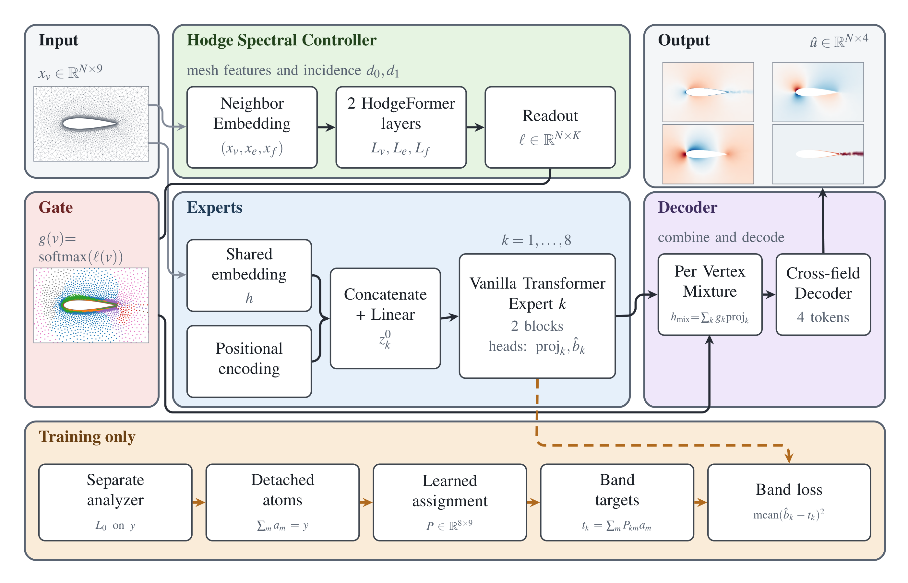
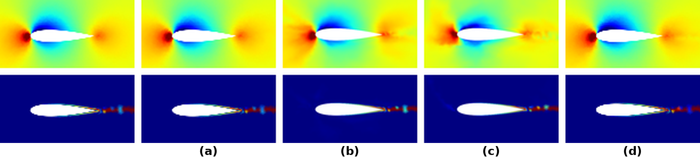
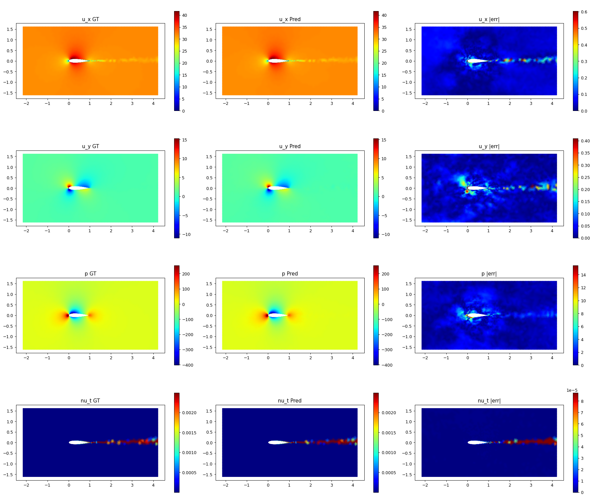
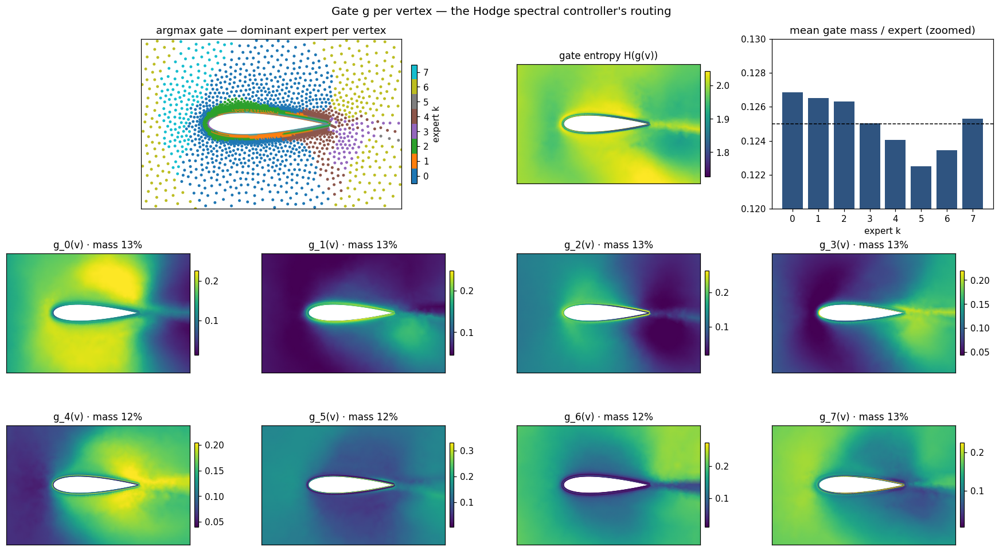
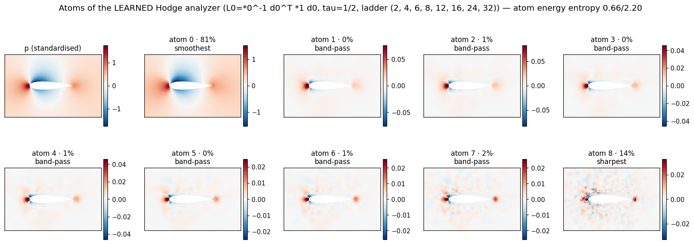
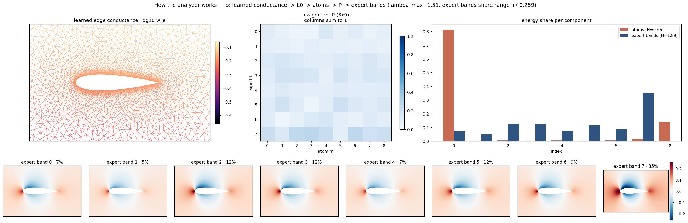
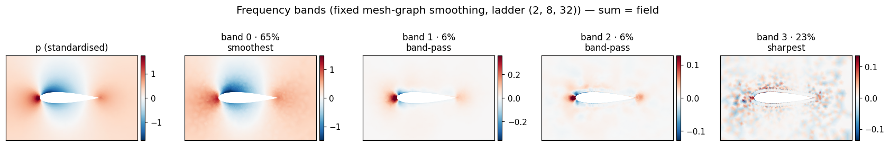

# Learnable Hodge–Laplacian Driven Mixture of Experts for Steady-PDE Surrogates on Coarse Unstructured Meshes

[Paper](https://arxiv.org/abs/2610.20585) · [Code](https://github.com/snousias/hodge-moe-pde/) · [Checkpoint](https://github.com/snousias/hodge-moe-pde/blob/master/checkpoints/hodgemoe_vef_best_ep400.pth) · [Dataset](https://huggingface.co/datasets/snousias/hodge-moe-pde-airfrans)

## Abstract

Surrogate models for steady partial differential equations on unstructured meshes often apply a single mixing mechanism to the whole solution. We propose a mixture of experts architecture supervised at different spectral scales. A controller that utilizes learnable laplacian matrices, referred to as Hodge Controller, receives the mesh geometry and input features and produces per-vertex weights that combine the expert feature vectors. During training, a separate discrete Laplacian $L_0=\star_0^{-1}d_0^{\!\top}\star_1d_0$ decomposes the reference fields into scale-dependent targets for auxiliary expert heads. We evaluate the model on AirFRANS, a steady Reynolds-averaged Navier–Stokes (RANS) airfoil benchmark, using remeshed triangular grids with approximately $9.6$k faces and $4.9$k vertices. On the official $800/200$ split, our model achieves $31\%$ lower relative $L_2$ error and $47\%$ lower interior mean squared error than Transolver on the same evaluation meshes, with approximately half as many parameters. Training allocations and checkpoint-selection procedures differ between our model and the baselines. Code: [https://github.com/snousias/hodge-moe-pde](https://github.com/snousias/hodge-moe-pde/).

## Contributions

- A Gaussian star construction ([Hodge controller](index.html#sec-controller)) that is symmetric positive definite whenever its neighbour support is mutual, and under which the assembled operator then has a real non-negative spectrum.
- An architecture that uses the learned discrete Hodge Laplacian to compute routing weights, rather than to compute the predicted fields.
- A supervision scheme in which a second, diagonal-star learnable Laplacian decomposes the target into a sequence of components ([Auxiliary targets](index.html#sec-analyzer)).
- An evaluation on the official AirFRANS split against a Transolver baseline, trained on the same working meshes with identical data, loss and metric code ([Results](index.html#sec-results)).

## Methodology

### Overview

We propose a mixture of transformer experts for steady-PDE prediction on unstructured meshes, with per-vertex weights computed by a learnable Laplacian controller. The model predicts velocity components $u_x,u_y$, pressure $p$, and turbulent kinematic viscosity $\nu_t$ at the vertices of an unstructured mesh. The prediction path consists of a shared embedding, a controller, transformer experts, and a field decoder ([Overview of the model](index.html#fig-arch)). The controller produces routing weights from vertex, edge, and face features together with the mesh incidence matrices and neighborhood indices. Each expert combines the shared embedding with fixed Fourier positional features and produces both a latent representation and an auxiliary prediction. The routing weights combine the latent representations, which the decoder maps to the four output fields. During training, a separate diagonal-star vertex Laplacian smooths the reference fields to construct telescoping atoms. A learned assignment combines these atoms into expert-specific supervision targets. The controller uses two **PSD-Hodge layers**, which keep the block structure of HodgeFormer [[11]](index.html#ref-nousias2026hodgeformer) and replace its softmax-parameterized stars with Gaussian stars intended to give a positive-semidefinite (PSD) construction.

### Simplicial complex and neighborhoods

The mesh is the simplicial complex $\mathcal M=(V,E,F)$, with $N=|V|$, $N_e=|E|$, and $N_f=|F|$, and signed incidence matrices $d_0\in\mathbb R^{N_e\times N}$ and $d_1\in\mathbb R^{N_f\times N_e}$ with non-zero entries $-1$ or $+1$. For each mesh element $i$, its neighborhood is the set of elements of the same type whose features contribute to the learned star at $i$; this set is the *operator support*, because it specifies the entries that may be nonzero in row $i$ of the star matrix. Vertex and edge neighbor lists are initially generated from graph-hop rings, with at most eight hops. The controller uses a capped set of entries, with $n_{vcap}=64$ for vertices and $n_{ecap}=32$ for edges. These lists are ordered by element index, so the retained entries are not necessarily the nearest neighbors, and truncation can remove the reverse of a retained neighbor relation. Each face neighborhood contains only the face itself. Unused positions are padded with $-1$ and do not contribute to the operator.

### Input features and embeddings

The nine vertex inputs are

$$x_v^{\mathrm{raw}}=[\mathrm{pos}^{\mathrm{raw}}_1,\mathrm{pos}^{\mathrm{raw}}_2,A_v^{\mathrm{dual}},u_{\mathrm{in}},v_{\mathrm{in}},\mathrm{SDF},n_x,n_y,\mathrm{is\_wall}],$$

where $\mathrm{pos}^{\mathrm{raw}}_1,\mathrm{pos}^{\mathrm{raw}}_2$ are physical coordinate columns, $A_v^{\mathrm{dual}}$ is the barycentric dual area, computed as one third of the sum of incident triangle areas, and SDF denotes signed distance. The columns $u_{\mathrm{in}},v_{\mathrm{in}}$ contain inlet velocity components, $n_x,n_y$ contain normal components, and $\mathrm{is\_wall}$ is the wall indicator. Each vertex-input column, including the wall indicator, is Z-score standardized using statistics pooled over vertices across the training meshes. The freestream speed is obtained from the inlet velocity components at the first vertex, and the dataset scales the four target fields by it:

$$U_\infty=\sqrt{u_{\mathrm{in}}^2+v_{\mathrm{in}}^2},\qquad \widetilde y=\left[\tfrac{u_x}{U_\infty},\tfrac{u_y}{U_\infty},\tfrac{p}{U_\infty^2},\tfrac{\nu_t}{U_\infty}\right],\qquad y_{vc}=\frac{\widetilde y_{vc}-\mu_c^{\mathrm{norm}}}{s_c^{\mathrm{norm}}+10^{-8}}.$$

The turbulent kinematic viscosity target remains linear, without a logarithmic transformation. Dividing $\nu_t$ by $U_\infty$ leaves units of length; a dimensionless target would also require a reference length, which is not explicit in this scaling.

The prediction branch maps the input features to one token per vertex through a shared two-layer perceptron with GELU activation, $h=W_2\mathrm{GELU}(W_1x_v)\in\mathbb R^{N\times d}$ with $d=192$. All eight experts receive the same token array $h$. The controller uses a separate neighbor embedding for vertex, edge, and face features and then maps each stream through its own three-layer perceptron, with ReLU after every linear layer.

### Hodge controller

**Learned star operators.** The learned operators follow the approach in HodgeFormer [[11]](index.html#ref-nousias2026hodgeformer), which retains compositions of incidence and Hodge matrices while parameterizing the Hodge matrices through attention. Each head first projects the normalized features to $\varphi_i=W_\varphi\mathrm{LN}(h_s)_i$, where $s\in\{v,e,f\}$. The controller has width $d_c=64$ and $H=4$ heads, so the per-head kernel-feature dimension is $d_h=16$. These projected features determine the interaction between element $i$ and each neighbor $j\in\mathcal N(i)$ through a Gaussian kernel,

$$w_{ij}=\exp\left(-\frac{\|\varphi_i-\varphi_j\|_2^2}{2\sigma^2}\right),\qquad \sigma=\operatorname{softplus}(\gamma)+10^{-8},$$

so that neighbors with similar projected features receive larger weights, while the learned bandwidth $\sigma$ controls how quickly the weights decrease with feature distance. The matrix $\Omega$ collects these weights on the effective support and is zero elsewhere. We normalize using the row sums $D_i=\sum_j\Omega_{ij}$ and combine the resulting operator with the identity:

$$\hat S_{ij}=\frac{\Omega_{ij}}{\sqrt{D_iD_j+10^{-8}}},\qquad \star x=(1-\beta)x+\beta\hat Sx,\qquad \beta=\tfrac12\operatorname{sigmoid}(\alpha).$$

A neighborhood is reciprocal when $j\in\mathcal N(i)$ implies $i\in\mathcal N(j)$. Under this condition the ideal normalized matrix $D^{-1/2}\Omega D^{-1/2}$ is symmetric with eigenvalues in $[-1,1]$, and the star is symmetric positive-definite with eigenvalues in $[1-2\beta,1]$. The configured caps and truncation can break reciprocity, and for an asymmetric support the identity contribution alone does not establish symmetry or the SPD property.

Face neighborhoods contain only the face itself, so the Gaussian star would return $x$ for every $\varphi$. The face star therefore uses a diagonal form that depends on the face features, $z_i=\|\varphi_i\|_2^2/(d_h\sigma^2)$ and $(\star_2x)_i=(1-\beta+\beta e^{-z_i})x_i$. Stars labeled as inverse operators have their own learnable parameters; they are not computed matrix inverses.

**Operator composition.** For one attention head,

$$\begin{aligned} L_v &:= \star_0^{-1}(x_v)\cdot d_0^T\cdot\star_1(x_e)\cdot d_0,\\ L_e &:= d_0\cdot\star_0^{-1}(x_v)\cdot d_0^T\cdot\star_1(x_e)+\star_1^{-1}(x_e)\cdot d_1^T\cdot\star_2(x_f)\cdot d_1,\\ L_f &:= d_1\cdot\star_1^{-1}(x_e)\cdot d_1^T\cdot\star_2(x_f). \end{aligned}$$

If the stars in $L_v$ are symmetric positive definite, then $Q=d_0^T\star_1(x_e)d_0$ is symmetric positive semidefinite and $L_v=\star_0^{-1}(x_v)Q\sim\star_0^{-1/2}(x_v)Q\star_0^{-1/2}(x_v)$, so $L_v$ has a real, nonnegative spectrum, although it is generally not symmetric in the Euclidean inner product.

**Controller architecture.** The controller applies two PSD-Hodge layers followed by a vertex readout. Each layer has four heads of width $16$ and feedforward width $256$. After the second layer, the controller reads only $h_v$ and computes

$$\ell=\mathrm{Linear}_{64\to8}\left(\mathrm{GELU}(\mathrm{Linear}_{64\to64}(\mathrm{LN}(h_v)))\right)\in\mathbb R^{N\times K},\qquad K=8.$$

The mixture module converts these logits into routing weights through a softmax without temperature scaling. The reported configuration updates vertices alone and reads edge features through its vertex operator; the VEF variant updates edges and faces as well.

### Transformer experts and decoder

Expert $k$ receives the token array $h$ joined with Fourier features of the two standardized coordinate columns of $x_v$:

$$z^0_k=W^k_{\text{in}}\big[\,h\;;\;\sin(2\pi\,\mathrm{pos}\,B_k)\;;\;\cos(2\pi\,\mathrm{pos}\,B_k)\,\big]\in\mathbb R^{N\times d_x},\qquad B_k=\sigma_kG_k\in\mathbb R^{2\times n_F},$$

where the expert width is $d_x=88$, the number of frequencies is $n_F=8$, and the entries of $G_k$ are drawn once from a standard normal distribution and then held fixed [[18]](index.html#ref-tancik2020fourier). The scales are geometric, $(\sigma_1,\ldots,\sigma_K)=(1.0,1.7,2.8,4.8,8.0,13.5,22.6,38.0)$, and are the only difference between the experts at initialization.

Each expert applies $L_x=2$ transformer blocks to $z^0_k$, with $h_x=8$ attention heads of width $11$ and feedforward width $352$. The experts receive no incidence matrices and no neighborhood indices. Two linear maps read the output of the last block: $\operatorname{proj}_k$, returning an array of width $d$, and $W^k_b$, returning the auxiliary prediction $\hat b_k\in\mathbb R^{N\times4}$, which is supervised against the per-expert target and is not used to form the field prediction.

All $K$ experts are evaluated at every vertex. The controller logits pass through a softmax, giving weights $g(v)\in\Delta^K$, and the expert representations are combined as $h_{\text{mix}}(v)=\sum_{k=1}^{K}g_k(v)\operatorname{proj}_k(z_k)(v)$. The weights set the combination and not the number of experts evaluated, so routing does not reduce expert computation.

The decoder applies layer normalization and dropout to $h_{\text{mix}}$ and forms one token per output channel by adding a row of a learned field embedding $E_{\mathrm{field}}\in\mathbb R^{4\times d}$. Two blocks act on the four tokens of one vertex, with width $d=192$, four heads of width $48$, and feedforward width $768$; the attention relates the output fields at a fixed vertex and does not mix vertices. A shared readout then returns one scalar per field, giving $\hat u\in\mathbb R^{N\times4}$.

### Auxiliary targets

The targets for the auxiliary predictions are built from the reference fields themselves. The reference field is separated into components that vary over different distances on the mesh, and each expert is assigned a combination of them. The separation is produced by repeated local averaging, with averaging weights defined on every edge as conductances. The final prediction is trained against the original reference fields and not against these components.

**Conductances.** A conductance $w_e>0$ is the weight that edge $e$ carries when a vertex value is replaced by an average over its neighbors. A weight is needed because the mesh cells differ in size, so averaging over the unweighted graph would cover different amounts of physical space in different regions of the same mesh. An edge network maps the $c_e$ features of each edge to a scalar through a hidden layer of width $64$ with GELU activation, and softplus with an added floor makes the result positive, $w_e=\operatorname{softplus}(\mathrm{MLP}_e(x_e))+\epsilon_w$ with $\epsilon_w=10^{-4}$. The conductances define

$$\star_1=\operatorname{diag}(w),\qquad \mu=|d_0|^\top w,\qquad \star_0=\operatorname{diag}(\mu),\qquad L_0=\star_0^{-1}d_0^\top\star_1d_0.$$

For any positive conductances $x^\top d_0^\top\star_1d_0x=\sum_{e=(i,j)}w_e(x_i-x_j)^2\ge0$, so $L_0$ is positive semidefinite by construction. Taking the vertex operator to be the total incident conductance, rather than a second learned quantity, is what bounds the spectrum: with this choice $L_0$ is the random-walk Laplacian and its eigenvalues lie in $[0,2]$. A separately learned vertex mass removes that bound, and on these graded meshes the largest eigenvalue then grows by several orders of magnitude.

**The solution at different spatial scales.** One smoothing step is $\bar y\leftarrow(I-\tau L_0)\bar y$ with $\tau=\tfrac12$. The eigenvalue bound makes this step stable for every sample without estimating the largest eigenvalue. Repeating the step $m$ times mixes each vertex with the vertices reachable within about $m$ edges, and a component with eigenvalue $\lambda$ is multiplied by $(1-\lambda/2)^m$. We retain the smoothed fields at $L=8$ step counts,

$$(m_0,\ldots,m_{L-1})=(2,4,6,8,12,16,24,32),\qquad \bar y^{(j)}=(I-\tau L_0)^{m_j}y,$$

and form $M=L+1=9$ components, called atoms:

$$a_0=\bar y^{(L-1)},\qquad a_i=\bar y^{(L-1-i)}-\bar y^{(L-i)}\quad(1\le i\le L-1),\qquad a_{M-1}=y-\bar y^{(0)}.$$

The differences cancel when the atoms are added, so $\sum_m a_m=y$ up to floating-point rounding, whatever the conductances are. The atoms are not an orthogonal decomposition; their spectral responses overlap, so they do not divide the field into disjoint frequency bands.

**Assignment.** There are $M=9$ atoms and $K=8$ experts. For each expert–atom pair we hold a score $\theta\in\mathbb R^{K\times M}$, and a softmax across experts converts the scores of each atom into nonnegative weights,

$$P_{km}=\frac{\exp(\theta_{km}/T)}{\sum_{k'=1}^{K}\exp(\theta_{k'm}/T)},\qquad T=1,\qquad t_k=\sum_{m=0}^{M-1}P_{km}a_m.$$

Each column of $P$ sums to one, so every atom is fully distributed among the expert targets and $\sum_{k=1}^{K}t_k=y$ algebraically. During training the atoms are detached, so the training loss updates the assignment scores without passing gradients through the atoms to the analyzer conductances. No constraint orders the expert targets from low to high frequency, and global Xavier initialization overwrites the constructor's preferred assignment scores.

### Training objective

$$\mathcal L=\mathcal L_{\mathrm{vol}}+\mathcal L_{\mathrm{surf}}+\lambda_b\operatorname{mean}_{v,c,k}(\hat b_{vck}-t_{vck})^2+\lambda_{\mathrm{bal}}K\sum_{k=1}^K\big(\bar g_k-\tfrac1K\big)^2+\lambda_{\mathrm{floor}}\sum_{k=1}^K[\mathrm{ReLU}(\rho-p_k)]^2.$$

Here $\mathcal L_{\mathrm{vol}}$ and $\mathcal L_{\mathrm{surf}}$ are mean squared errors of the normalized field residual over the non-wall and the wall vertices, $\bar g_k$ is expert $k$'s routing weight averaged over the batch and vertices, and $p_k$ is its assigned target's share of the total squared target norm. We use $(\lambda_b,\lambda_{\mathrm{bal}},\lambda_{\mathrm{floor}})=(0.5,0.01,1.0)$ and $\rho=0.02$.

## Simulation Setup

AirFRANS [[1]](index.html#ref-bonnet2022airfrans) provides vertex positions, input features, and four solution fields. We generate anisotropic triangular working meshes with gmsh [[16]](index.html#ref-geuzaine2009gmsh), each with approximately $4.9$k vertices and refinement near the airfoil, and interpolate the reference fields onto them. The data is two-dimensional, and coordinates are embedded at $z=0$. The nine vertex inputs encode geometry, inlet velocity, signed distance, the normals supplied by the dataset, and wall membership. Boundary conditions enter through these features. The wall indicator selects the vertices that form the surface term of the training objective and the wall error metric. Edge features determine the analyzer conductances. The reported controller updates vertices alone and reads edge features in its vertex operator; the VEF variant updates edges and faces as well.

We use the official $800/200$ split. Each case has up to eight remeshes, and one of them is drawn at random every time the case is read during training; evaluation uses one fixed mesh per case. Targets are scaled by the sample's freestream speed and standardized using training statistics.

Per-field relative $L_2$ and $R^2$ are evaluated in physical units. Volume and Surf are mean squared errors of the physical prediction error divided by the per-field standard deviation of the physical targets over the training set, taken over the non-wall and the wall vertices respectively. We also report the relative error of the lift coefficient and its Spearman correlation across test cases. All models are evaluated against interpolated targets on the same working meshes, so these numbers are not directly comparable with benchmark scores computed on the original meshes.

Our checkpoint is selected from $20$ checkpoints by test-set error, whereas the baselines use validation-based selection. Our models train on all $800$ training cases, while the baselines reserve $80$ for validation. These protocol differences limit attribution of the reported differences to architecture alone. Training uses AdamW with a one-cycle schedule for $400$ epochs and one mesh per batch.

## Results

**Comparison on the official AirFRANS $800/200$ split.** Every row is evaluated on the same $\approx4.9$k-vertex working meshes and evaluation metrics. Baselines use their full input-feature arms; training and checkpoint-selection differences are specified in [Simulation Setup](index.html#sec-setup). *Mesh use* names how mesh structure reaches the prediction: *none* for a point-set model, *operator* when a learned Hodge Laplacian computes the fields, *router* when it computes only the mixing weights. $C_L$ is the relative error of the lift over the $200$ test cases and $\rho_L$ its Spearman correlation with the reference.

| Model | Params | Mesh Use | rel-$L_2$ ↓ | $R^2$ ↑ | Volume ↓ | Surf ↓ | $C_L$ ↓ | $\rho_L$ ↑ |
| --- | --- | --- | --- | --- | --- | --- | --- | --- |
| Transolver [2] | 6.00M | none | 0.0436 | 0.9953 | 0.00265 | **0.00143** | **0.0103** | **0.99989** |
| PointNet [17] | 0.08M | none | 0.0689 | 0.9904 | 0.00451 | 0.00440 | 0.0149 | 0.99965 |
| Pointwise MLP | 0.02M | none | 0.1743 | 0.9404 | 0.03576 | 0.03969 | 0.0860 | 0.99338 |
| PSD-star HodgeFormer [11] | 0.47M | operator | 0.0800 | 0.9885 | 0.01028 | 0.01048 | 0.0681 | 0.99883 |
| Hodge-routed MoE (ours) | 3.02M | router | **0.0300** | **0.9983** | **0.00140** | 0.00164 | 0.0225 | 0.99988 |

Our model has the lowest relative $L_2$ error and the lowest interior mean squared error of the five, $31\%$ and $47\%$ below Transolver at half its parameter count. Transolver has the lower error on the two wall quantities, by a factor of $1.14$ on the surface error and $2.2$ on the lift coefficient. The fourth row is a HodgeFormer surrogate, which keeps the learned Hodge Laplacian in the prediction path. In the per-field breakdown, our model has the lowest relative $L_2$ error on three of the four fields and the second lowest on $u_y$, and the largest difference is on the eddy viscosity, the least accurate output of every model, where our error is $46\%$ below Transolver's. The design was selected through ablations over the source of the gate, the width of the predictor, fixed against learned band boundaries, the guard against an empty band, and the number of cochain degrees the controller operates on.

### Complete comparison

Official AirFRANS $800/200$ split, evaluation on the $\approx4.9$k-vertex mesh, the same test meshes and evaluation metrics for every row. Objectives differ across loss ablations.

| Model | Mesh Use | Params | rel-$L_2$ ↓ | $R^2$ ↑ | Volume ↓ | Surf ↓ | $C_L$ ↓ |
| --- | --- | --- | --- | --- | --- | --- | --- |
| Hodge-routed MoE (VEF) | router | 3.11M | 0.0359 | 0.9978 | 0.00182 | 0.00180 | 0.0277 |
| Hodge-routed MoE ($V$, ours) | router | 3.02M | **0.0300** | **0.9983** | **0.00140** | 0.00164 | 0.0225 |
| &nbsp;&nbsp;wide experts ($V$) | router | 5.68M | 0.0341 | 0.9979 | 0.00163 | 0.00219 | 0.0286 |
| Learned-band MoE | bands | 2.75M | 0.0345 | 0.9979 | 0.00165 | 0.00192 | 0.0265 |
| Fixed-band MoE | bands | 2.75M | 0.0351 | 0.9978 | 0.00178 | 0.00184 | 0.0280 |
| &nbsp;&nbsp;+ wall-surface branch | bands | 3.00M | 0.0378 | 0.9973 | 0.00196 | 0.00227 | 0.0247 |
| &nbsp;&nbsp;entropy-balanced, detached | bands | 2.75M | 0.0402 | 0.9973 | 0.00206 | 0.00214 | 0.0270 |
| &nbsp;&nbsp;entropy-balanced | bands | 2.75M | 0.0412 | 0.9972 | 0.00198 | 0.00233 | 0.0322 |
| Transolver, all inputs [2] | none | 6.0M | 0.0436 | 0.9953 | 0.00265 | 0.00143 | 0.0103 |
| Transolver, pos+inlet | none | 6.00M | 0.0439 | 0.9954 | 0.00270 | 0.00140 | **0.0078** |
| Transolver, +SDF+normals | none | 6.00M | 0.0440 | 0.9952 | 0.00286 | **0.00137** | 0.0098 |
| Wide plain transformer | none | 2.72M | 0.0446 | 0.9960 | 0.00265 | 0.00192 | 0.0245 |
| &nbsp;&nbsp;+ lift loss | none | 2.72M | 0.0458 | 0.9960 | 0.00248 | 0.00296 | 0.0378 |
| Plain transformer | none | 0.31M | 0.0544 | 0.9943 | 0.00374 | 0.00300 | 0.0173 |
| PointNet, all inputs [17] | none | 0.08M | 0.0689 | 0.9904 | 0.00451 | 0.00440 | 0.0149 |
| Pointwise MLP, all inputs | none | 0.02M | 0.1743 | 0.9404 | 0.03576 | 0.03969 | 0.0860 |
| PSD-star HodgeFormer, + surface loss [11] | operator | 0.47M | 0.0800 | 0.9885 | 0.01028 | 0.01048 | 0.0681 |
| PSD-star HodgeFormer, + decoder | operator | 0.47M | 0.0822 | 0.9884 | 0.00803 | 0.01205 | 0.0567 |
| PSD-star HodgeFormer | operator | 0.45M | 0.1154 | 0.9769 | 0.01446 | 0.03174 | 0.1747 |

### Per-field relative $L_2$

Errors for the VEF configuration, the reported vertex-only configuration ($V$), and comparison models. Metrics use the selected checkpoint of each run.

| Model | $u_x$ | $u_y$ | $p$ | $\nu_t$ |
| --- | --- | --- | --- | --- |
| Hodge-routed MoE (VEF) | 0.0067 | 0.0348 | 0.0380 | 0.0642 |
| Hodge-routed MoE ($V$, ours) | **0.0056** | 0.0259 | **0.0255** | **0.0629** |
| &nbsp;&nbsp;wide experts ($V$) | 0.0072 | 0.0319 | 0.0337 | 0.0638 |
| Learned-band MoE | 0.0068 | 0.0288 | 0.0365 | 0.0658 |
| Fixed-band MoE | 0.0068 | 0.0312 | 0.0346 | 0.0679 |
| &nbsp;&nbsp;+ wall-surface branch | 0.0064 | 0.0293 | 0.0342 | 0.0812 |
| Transolver, all inputs [2] | 0.0067 | **0.0220** | 0.0298 | 0.1158 |
| Wide plain transformer | 0.0059 | 0.0330 | 0.0326 | 0.1068 |
| Plain transformer | 0.0067 | 0.0554 | 0.0349 | 0.1205 |
| PSD-star HodgeFormer, best [11] | 0.0149 | 0.0650 | 0.0852 | 0.1548 |
| PointNet, all inputs [17] | 0.0125 | 0.0540 | 0.0655 | 0.1435 |
| Pointwise MLP, all inputs | 0.0518 | 0.1865 | 0.1765 | 0.2825 |

### Per-field Volume and Surf

AirFRANS-native normalized mean squared errors on non-wall and wall vertices, respectively, at the checkpoint selected by mean relative $L_2$ for each run.

| Model | Vol $u_x$ | Vol $u_y$ | Vol $p$ | Vol $\nu_t$ | Surf $u_x$ | Surf $u_y$ | Surf $p$ | Surf $\nu_t$ |
| --- | --- | --- | --- | --- | --- | --- | --- | --- |
| Hodge-routed MoE (VEF) | 0.00019 | 0.00096 | 0.00077 | 0.00534 | 0.00079 | 0.00197 | 0.00272 | 0.00173 |
| Hodge-routed MoE ($V$, ours) | 0.00011 | 0.00052 | 0.00031 | 0.00466 | 0.00073 | 0.00174 | 0.00248 | 0.00160 |
| Learned-band MoE | 0.00019 | 0.00063 | 0.00072 | 0.00506 | 0.00087 | 0.00195 | 0.00307 | 0.00181 |
| Fixed-band MoE | 0.00019 | 0.00086 | 0.00069 | 0.00539 | 0.00090 | 0.00198 | 0.00296 | 0.00152 |
| Wide plain transformer | 0.00017 | 0.00109 | 0.00074 | 0.00859 | 0.00062 | 0.00191 | 0.00313 | 0.00201 |
| Plain transformer | 0.00019 | 0.00279 | 0.00060 | 0.01140 | 0.00088 | 0.00403 | 0.00431 | 0.00278 |
| PSD-star HodgeFormer, best | 0.00114 | 0.00476 | 0.00420 | 0.03103 | 0.00406 | 0.00609 | 0.01801 | 0.01378 |

### Checkpoint sweep

Separate minimum mean relative $L_2$ and Volume values with their epochs. †The VEF configuration was trained for $400$ epochs plus a $200$-epoch continuation with peak learning rate $2\times10^{-4}$ and swept at $30$ checkpoints rather than $20$.

| Model | Checkpoints | Best rel-$L_2$ (epoch) | Best Volume (epoch) |
| --- | --- | --- | --- |
| Hodge-routed MoE (VEF)† | 30 | 0.0359 (560) | 0.00182 (560) |
| Hodge-routed MoE ($V$, ours) | 20 | 0.0300 (380) | 0.00139 (400) |
| &nbsp;&nbsp;wide experts ($V$) | 20 | 0.0341 (400) | 0.00163 (400) |
| Learned-band MoE | 20 | 0.0345 (380) | 0.00165 (380) |
| Fixed-band MoE | 20 | 0.0351 (400) | 0.00178 (380) |
| Plain transformer | 20 | 0.0544 (320) | 0.00339 (400) |
| PSD-star HodgeFormer, best | 20 | 0.0800 (320) | 0.00651 (400) |

For the vertex-only configuration, the minimum mean relative $L_2$ and the minimum Volume occur at epochs $380$ and $400$, respectively; the Volume value in the complete comparison is $0.00140$ at the relative-$L_2$-selected checkpoint, rather than the separate minimum $0.00139$. The reported checkpoint gives $C_L=0.0225$ and $\rho_L=0.99988$; the VEF lift error is $C_L=0.0277$. A separate $10$-case contour comparison using the reported checkpoint gives relative lift errors of $0.0220$ for the band and $0.0205$ for the surface loop.

## Diagnostics

This section reports the analyzer, assignment, and gate diagnostics for the vertex-only configuration ($V$) at epoch $380$. The analyzer’s diagonal stars are

$$\star_1=\operatorname{diag}(w_e),\quad w_e=\mathrm{softplus}(\mathrm{MLP}_e(x_e))+\epsilon_w;\qquad \star_0=\operatorname{diag}(\mu_v),\quad \mu_v=\sum_{e\ni v}w_e,$$

where $w_e$, the edge conductance, is the analyzer's only parameterised content. The atoms are the telescoping differences of the forward-Euler smoothing ladder $\bar y^{(j)}=(I-\tau L_0)^{m_j}y$, and the assignment $P$ groups them into per-expert band targets $t_k$, with $\sum_kP_{km}=1$ for every $m$.

The analyzer atoms are detached before assignment, so the gradient of the training objective stops at the atoms and the conductance network holds its initialized values. Conductance is a function of edge geometry, and its contribution to smoothing is normalized by the incident degree, so that the weight of neighbor $j$ at vertex $i$ is proportional to $w_{ij}/\mu_i$, and the degree-normalized weight therefore governs how quickly local field structure is smoothed.

The plotted atom shares are normalized squared norms for the illustrated field, $[0.812,0.003,0.006,0.003,0.006,0.003,0.006,0.019,0.143]$. The atoms overlap, so the shares describe relative magnitude within an overlapping family. Approximately $81\%$ of the summed squared atom norms is in the coarsest atom and $14\%$ in the finest residual. These are case-level values for the displayed mesh, while the test-set means are listed in the [per-field table](index.html#perfield-results).

The energy-floor penalty acts on the assigned targets $t_k$, so its activation follows the assigned-target norm shares. The vertex-only training log records a zero floor penalty at epoch $380$, a value read at that epoch. Global Xavier initialization overwrites the constructor’s preferred atom-to-expert grouping, so the assignment is learned from a symmetric start.



Overview of the model. The Hodge controller routes transformer experts that combine shared embeddings with positional encodings at different frequency scales. Their representations are mixed and decoded into four fields. During training, a separate analyzer decomposes the reference fields into atoms, which a learned assignment combines into targets for the auxiliary expert heads (dashed path).



Pressure $p$ (top) and turbulent viscosity $\nu_t$ (bottom) on the reference colour scales; left to right, the CFD reference, (a) our model, (b) Transolver, (c) PointNet, and (d) the best PSD-star HodgeFormer. Values beneath each model panel are mean relative $L_2$ errors over the $200$ test cases. The mean relative $L_2$ is $0.063$, $0.116$, $0.144$ and $0.155$ on $\nu_t$ for (a)–(d), against $0.026$, $0.030$, $0.066$ and $0.085$ on $p$.



**One test case from the vertex-only configuration (epoch $380$).** Columns are the reference, the prediction and the absolute error; rows are $u_x$, $u_y$, $p$ and $\nu_t$. All panels are on the model's own working mesh in physical units, with the reference and the prediction sharing each field's colour scale. The per-field relative $L_2$ for this case is $0.0047$, $0.0260$, $0.0281$ and $0.0676$, compared with test-set means of $0.0056$, $0.0259$, $0.0255$ and $0.0629$.



**Vertex-only gate $g(v)$ at epoch $380$.** The top row shows the dominant expert at each vertex, the per-vertex gate entropy, and the mean routing weight over vertices per expert against the uniform $1/K$ line, with the vertical axis restricted to $0.120$–$0.130$, and the bottom row shows the eight weight fields $g_k(v)$. The dominant-expert panel displays an argmax of soft weights, and all experts are evaluated. These panels describe routing on the displayed mesh.



**Vertex-only analyzer atoms at epoch $380$.** Nine telescoping atoms for the illustrated pressure field. Atom $0$ is the most-smoothed component, atoms $1$–$7$ are differences between smoothing levels, and atom $8$ is the residual after the fewest smoothing steps. The first and last components account for approximately $81\%$ and $14\%$ of the summed squared atom norms. Their sum reconstructs the field algebraically, subject to floating-point rounding. The conductance network holds its initialized values.



**Vertex-only analyzer and assignment at epoch $380$.** The panels show the edge conductance $w_e$ from the initialized conductance network, then the learned $8\times9$ assignment $P$, then the eight assigned targets on a shared symmetric colour range, and finally the normalized squared component norms before and after assignment. Global Xavier initialization overwrites the constructor's preferred assignment logits.



**The fixed reference decomposition** of the pressure field with the ladder $(2,8,32)$ on the unweighted adjacency, for comparison with the vertex-only analyzer example in [Vertex-only analyzer atoms at epoch 380](index.html#fig-atoms). This decomposition is independent of a trained controller checkpoint. The normalized squared component norms for this illustrated field are $[0.65,0.06,0.06,0.23]$, and the components overlap.

## Discussion and Conclusion

We propose a Hodge-routed mixture of transformer experts for steady-PDE prediction on unstructured meshes. A learned Hodge Laplacian computes the routing weights, and a separate analyzer constructs multiscale supervision targets. On the AirFRANS working mesh, mean relative $L_2$ and interior mean squared errors decrease by $31\%$ and $47\%$ relative to Transolver, from $0.0436$ to $0.0300$ and from $0.00265$ to $0.00140$, respectively. The largest per-field improvement is in turbulent viscosity, whose relative $L_2$ error decreases by approximately $46\%$, from $0.1158$ to $0.0629$ ([Per-field relative L2 for selected models](index.html#perfield-results)). Introducing the Hodge controller into the learned-band mixture reduces mean relative $L_2$ error from $0.0345$ to $0.0300$ ([Complete comparison](index.html#complete-results)), with larger additional gains in velocity and pressure than in turbulent viscosity.

The mean relative $L_2$ error for pressure is lower than Transolver's, while surface and relative lift-coefficient errors are higher, at $0.00164$ versus $0.00143$ and at $0.0225$ versus $0.0103$, respectively ([Comparison on the official AirFRANS 800/200 split](index.html#main-results)). Both models retain lift rank correlations above $0.9998$, preserving case ordering more accurately than force magnitudes. Pressure errors along the airfoil contour therefore require further examination.

We follow Transolver's evaluation format on the official AirFRANS $800/200$ split, with one training run per configuration and evaluation on a remeshed working mesh of approximately $4.9$K vertices. The results do not establish accuracy at the original CFD resolution or robustness across random seeds. The analyzer's algebraic target reconstruction holds independently of the controller's conditional spectral guarantee. The implementation does not enforce the reciprocal neighborhoods required by that guarantee, and prediction accuracy does not validate it. Every expert is evaluated, and dense attention scales quadratically with mesh size.

## Code, Checkpoint and Data

The code is released under the MIT License at [github.com/snousias/hodge-moe-pde](https://github.com/snousias/hodge-moe-pde/). The repository contains the **vertex, edge and face (VEF) routing variant**, its training and evaluation code, the normalization statistics, and a trained checkpoint. Operator definitions and an audit of which modules receive optimizer updates are given in the [architecture document](https://github.com/snousias/hodge-moe-pde/blob/master/docs/ARCHITECTURE.md).

### Released checkpoint

The supplied checkpoint, [`hodgemoe_vef_best_ep400.pth`](https://github.com/snousias/hodge-moe-pde/blob/master/checkpoints/hodgemoe_vef_best_ep400.pth), contains $3{,}106{,}490$ parameters and was trained for $400$ epochs in fp32. Its normalization statistics are in [`norm_stats.npz`](https://github.com/snousias/hodge-moe-pde/blob/master/checkpoints/norm_stats.npz). The values below come from evaluating this checkpoint on all $200$ official test cases; its final epoch is also the best of this run's $20$-checkpoint sweep.

| Metric | Released checkpoint |
| --- | --- |
| Mean relative $L_2$ | **0.0329** |
| Mean $R^2$ | 0.9981 |
| Volume | 0.00170 |
| Surf | 0.00202 |
| Mesh-native $C_L$ relative error | 0.0313 |
| Lift Spearman correlation | 0.9999 |

This checkpoint is a separate run from both the paper's reported vertex-only model ($0.0300$ at epoch $380$) and the supplementary VEF experiment ($0.0359$, selected at epoch $560$ in a run with a different edge support cap and a $200$-epoch continuation). The complete release metrics, per-field errors and checkpoint sweep are reported in [docs/RESULTS.md](https://github.com/snousias/hodge-moe-pde/blob/master/docs/RESULTS.md), and the checkpoint's origin and checksum in [checkpoints/PROVENANCE.md](https://github.com/snousias/hodge-moe-pde/blob/master/checkpoints/PROVENANCE.md).

### Dataset

The preprocessed AirFRANS mesh pool is hosted on Hugging Face at [snousias/hodge-moe-pde-airfrans](https://huggingface.co/datasets/snousias/hodge-moe-pde-airfrans) (ODbL, derived from AirFRANS). It holds $6{,}600$ mesh files and the target statistics, approximately $1.2$ GB, with eight meshes per training case and one per test case. Geometry caches are built on first use and require approximately $20$ GB for evaluation and $251$ GB for training. Download commands and placement are given in the [dataset README](https://github.com/snousias/hodge-moe-pde/blob/master/dataset/README.md). AirFRANS has its own dataset license and citation requirements.

### Quickstart

```bash
git clone https://github.com/snousias/hodge-moe-pde
cd hodge-moe-pde
conda env create -f environment.yml
conda activate hodgemoe-vef
pip install -e third_party/mesh_opformer -e third_party/mesh_sim -e third_party/mesh_opformer_geodesic

# place the Hugging Face mesh pool under dataset/processed_augmented/, then
bash scripts/run_eval.sh    # field accuracy, mesh-native lift, qualitative plots
bash scripts/run_train.sh   # AdamW, OneCycle, 400 epochs, one mesh per batch
```

## BibTeX

```bibtex
@article{nousias2026hodgemoepde,
  author    = {Nousias, Stavros and Nousias, Akis and Gkrispanis, Konstantinos},
  title     = {Learnable Hodge-Laplacian Driven Mixture of Experts for Steady-PDE Surrogates on Coarse Unstructured Meshes},
  journal   = {arXiv preprint arXiv:2610.20585},
  year      = {2026}
}
```
