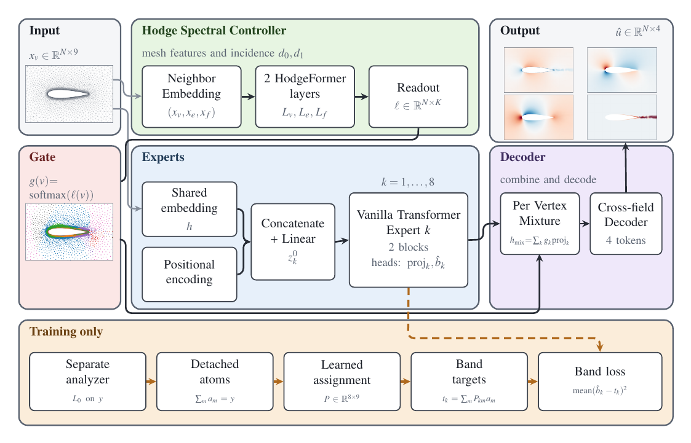
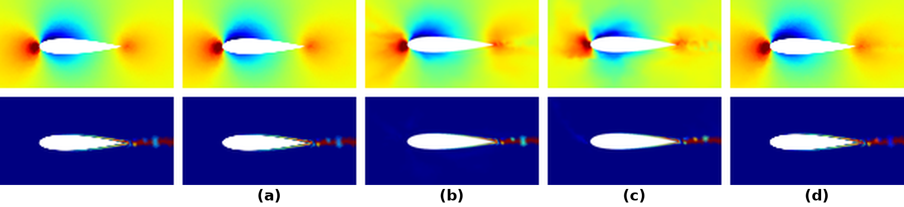
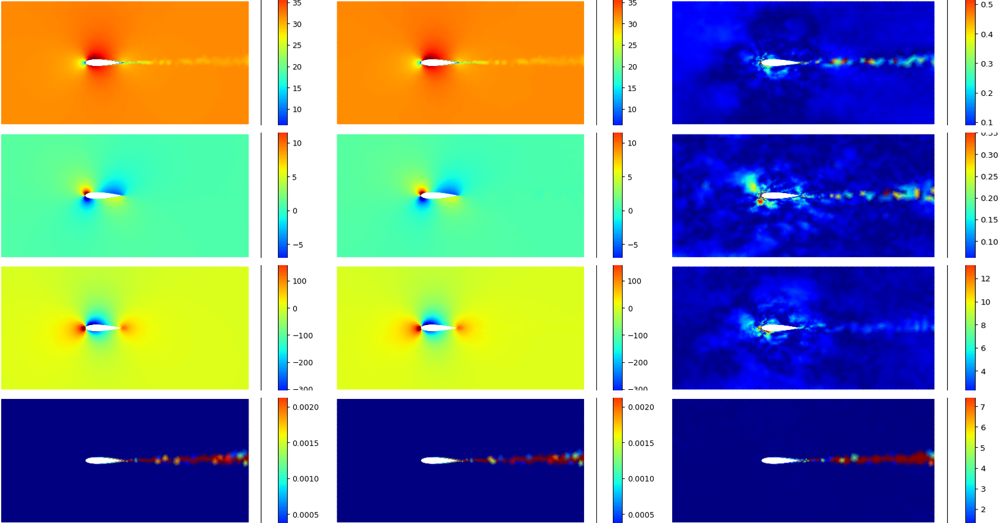
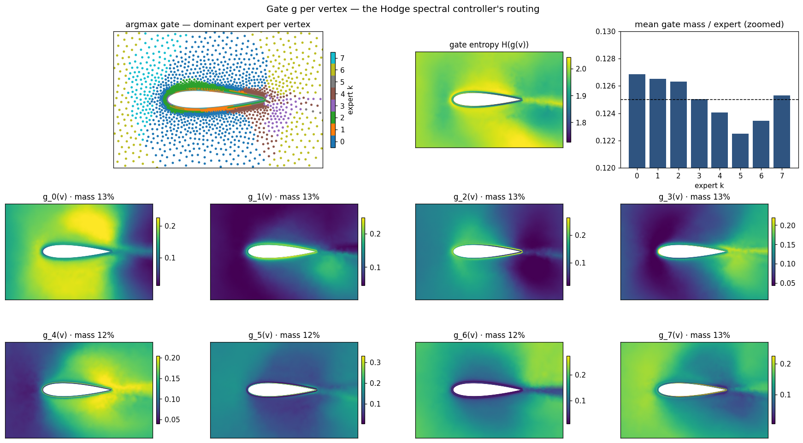
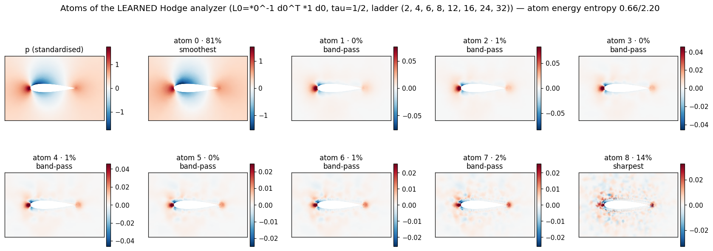
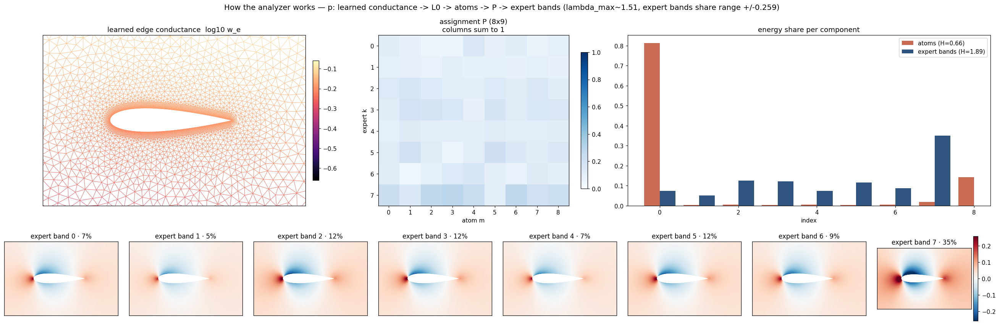
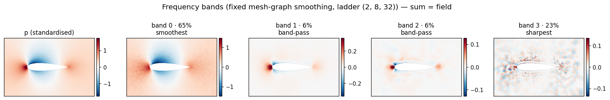

# Learnable Hodge–Laplacian Driven Mixture of Experts for Steady-PDE Surrogates on Coarse Unstructured Meshes

[Paper](https://arxiv.org/abs/2610.20585) · [Code](https://github.com/snousias/hodge-moe-pde/)

## Abstract

Surrogate models for steady partial differential equations on unstructured meshes often apply a single mixing mechanism to the whole solution. We propose a mixture of experts architecture supervised at different spectral scales. A controller that utilizes learnable laplacian matrices, referred to as Hodge Controller, receives the mesh geometry and input features and produces per-vertex weights that combine the expert representations. During training, a separate discrete Laplacian $L_0=\star_0^{-1}d_0^{\!\top}\star_1d_0$ decomposes the reference fields into scale-dependent targets for auxiliary expert heads. We evaluate the model on AirFRANS, a steady Reynolds-averaged Navier–Stokes (RANS) airfoil benchmark, using remeshed triangular grids with approximately $9.6$k faces and $4.9$k vertices. On the official $800/200$ split, our model achieves $31\%$ lower relative $L_2$ error and $47\%$ lower interior mean squared error than Transolver on the same evaluation meshes, with approximately half as many parameters. Training allocations and checkpoint-selection procedures differ between our model and the baselines. Code: [https://github.com/snousias/hodge-moe-pde](https://github.com/snousias/hodge-moe-pde/).

## Methodology

We propose a mixture of transformer experts for steady-PDE prediction on unstructured meshes, with per-vertex weights computed by a learnable Laplacian controller. The model predicts velocity components $u_x,u_y$, pressure $p$, and turbulent kinematic viscosity $\nu_t$ at the vertices of an unstructured mesh. It consists of a shared vertex embedding, eight transformer experts, a Hodge controller, and a field decoder ([Overview of the model](index.html#fig-arch)). A separate analyzer constructs auxiliary supervision targets during training.

The prediction path consists of a shared vertex embedding, a Hodge controller, transformer experts, and a field decoder. The controller produces routing weights from vertex, edge, and face features together with the mesh incidence matrices and neighborhood indices. Each expert combines the shared embedding with fixed Fourier positional features and produces both a latent representation and an auxiliary band prediction. The routing weights combine the latent representations, which the decoder maps to the four output fields. During training, a separate diagonal-star vertex Laplacian smooths the reference fields to construct telescoping atoms. A learned assignment combines these atoms into expert-specific supervision targets. This analyzer is absent from inference, and its conductances receive no gradients from the training loss because the atoms are detached before assignment.

The proposed VEF controller applies $L_0$ to vertices, $L_1=L_1^{\text{down}}+L_1^{\text{up}}$ to edges, and $L_2^{\text{down}}$ to faces, using the incidence composition in [Operator composition](https://arxiv.org/abs/2610.20585). All Hodge attention updates read the pre-update streams and are computed simultaneously. The vertex-only configuration ($V$) applies the vertex Hodge attention update without edge or face Hodge attention updates. Its edge and face streams retain position-wise residual feedforward updates; edge features therefore continue to enter the vertex star. Both configurations produce routing logits from the final vertex stream.

## Simulation Setup

AirFRANS [[1]](index.html#ref-bonnet2022airfrans) provides node positions, input features, and four solution fields. We generate anisotropic triangular working meshes with gmsh [[16]](index.html#ref-geuzaine2009gmsh), using approximately $4.9$k vertices with refinement near the airfoil, and interpolate the reference fields onto them. Coordinates are embedded at $z=0$ to construct the incidence matrices and geometric features.

We use the official $800/200$ split. Each training access selects one of up to eight available remeshes; evaluation uses a fixed mesh per case. Targets are scaled by the sample's freestream speed and standardized using training statistics, as specified in [Input features](https://arxiv.org/abs/2610.20585).

Per-field relative $L_2$ and $R^2$ are evaluated in physical units. Volume and Surf are globally normalized mean squared errors on non-wall and wall vertices, respectively. We also report mesh-native relative lift-coefficient error and its Spearman correlation across test cases. All models are evaluated against interpolated targets on the same working meshes; these results are not directly comparable with original-mesh benchmark scores.

The Hodge-routed configurations train on all $800$ official training cases. Each time a training case is loaded, one of its available remeshes is selected, from a pool of up to eight. Evaluation uses a fixed mesh for each of the $200$ official test cases. The external baselines reserve $80$ of the $800$ training cases for validation and train on the remaining $720$. Their checkpoints are selected using validation errors.

The reported Hodge-routed checkpoints are selected by mean relative $L_2$ error on the $200$ test cases: epoch $560$ among $30$ checkpoints for VEF, and epoch $380$ among $20$ checkpoints for $V$. The reported test errors are therefore also used to choose the checkpoint. Error differences from the external baselines cannot be attributed to architecture alone because the training cases and checkpoint-selection procedures differ. The external all-input configuration has eight channels and omits the wall-indicator channel used by the Hodge-routed configurations ([Input-Feature Ablation of the Baseline](https://arxiv.org/abs/2610.20585)).

## Results

**Comparison on the official AirFRANS $800/200$ split.** Every row is evaluated on the same $\approx4.9$k-vertex working meshes and evaluation metrics. Baselines use their full input-feature arms; training and checkpoint-selection differences are specified in [Simulation Setup](https://arxiv.org/abs/2610.20585). *Mesh use* names how mesh structure reaches the prediction: *none* for a point-set model, *operator* when a learned Hodge Laplacian computes the fields, *router* when it computes only the mixing weights. $C_L$ is the relative error of the mesh-native lift over the $200$ test cases and $\rho_L$ its Spearman correlation with the reference.

[Comparison on the official AirFRANS 800/200 split](index.html#main-results) compares the models on the official split. Our model has the lowest relative $L_2$ error and the lowest interior mean squared error of the five, $31\%$ and $47\%$ below Transolver at half its parameter count. Transolver has the lower error on the two wall quantities, by a factor of $1.14$ on the surface error and $2.2$ on the lift coefficient. The fourth row is a HodgeFormer surrogate, which keeps the learned Hodge Laplacian in the prediction path. The per-field breakdown is given in full in the supplementary material: our model has the lowest relative $L_2$ error on three of the four fields and the second lowest on $u_y$, and the largest difference is on the eddy viscosity, the least accurate output of every model, where our error is $46\%$ below Transolver's. The aggregate is the mean over the four fields. The fixed reference decomposition is illustrated for pressure in [The fixed reference decomposition](index.html#fig-bands). The design was selected through ablations over the source of the gate, the width of the predictor, fixed against learned band boundaries, the guard against an empty band, and the number of cochain degrees the controller operates on, given in the supplementary material.

| Model | Params | Mesh Use | rel-$L_2$ ↓ | $R^2$ ↑ | Volume ↓ | Surf ↓ | $C_L$ ↓ | $\rho_L$ ↑ |
| --- | --- | --- | --- | --- | --- | --- | --- | --- |
| Transolver [2] | 6.00M | none | 0.0436 | 0.9953 | 0.00265 | 0.00143 | 0.0103 | 0.99989 |
| PointNet [17] | 0.08M | none | 0.0689 | 0.9904 | 0.00451 | 0.00440 | 0.0149 | 0.99965 |
| Pointwise MLP | 0.02M | none | 0.1743 | 0.9404 | 0.03576 | 0.03969 | 0.0860 | 0.99338 |
| PSD-star HodgeFormer [11] | 0.47M | operator | 0.0800 | 0.9885 | 0.01028 | 0.01048 | 0.0681 | 0.99883 |
| Hodge-routed MoE (ours) | 3.02M | router | 0.0300 | 0.9983 | 0.00140 | 0.00164 | 0.0225 | 0.99988 |

### Per-field relative $L_2$

**Per-field relative $L_2$ for selected models.** Errors for the proposed VEF configuration, the vertex-only configuration ($V$), and comparison models. Metrics use the selected checkpoint of each run. Best values per field are in bold.

| Model | $u_x$ | $u_y$ | $p$ | $\nu_t$ |
| --- | --- | --- | --- | --- |
| Hodge-routed MoE (ours) | 0.0056 | 0.0259 | 0.0255 | 0.0629 |
| Hodge-routed MoE (VEF) | 0.0067 | 0.0348 | 0.0380 | 0.0642 |
| Learned-band MoE | 0.0068 | 0.0288 | 0.0365 | 0.0658 |
| Fixed-band MoE | 0.0068 | 0.0312 | 0.0346 | 0.0679 |
| Transolver [2] | 0.0067 | 0.0220 | 0.0298 | 0.1158 |
| Wide plain transformer | 0.0059 | 0.0330 | 0.0326 | 0.1068 |
| PSD-star HodgeFormer [11] | 0.0149 | 0.0650 | 0.0852 | 0.1548 |
| PointNet [17] | 0.0125 | 0.0540 | 0.0655 | 0.1435 |

## Diagnostics of the Vertex-only Configuration

This section retains the analyzer, assignment, and gate diagnostics for the vertex-only configuration ($V$) at epoch $380$. These figures and measurements do not describe the proposed VEF checkpoint at epoch $560$. The analyzer's diagonal stars are

Overview of the model. The Hodge controller routes transformer experts that combine shared vertex embeddings with positional encodings at different frequency scales. Their representations are mixed and decoded into four fields. During training, a separate analyzer decomposes the reference fields into atoms, which a learned assignment combines into targets for the auxiliary expert heads (dashed path).

Pressure $p$ (top) and turbulent viscosity $\nu_t$ (bottom) on the reference colour scales; left to right, the CFD reference, (a) our model, (b) Transolver, (c) PointNet, and (d) the best PSD-star HodgeFormer. Values beneath each model panel are mean relative $L_2$ errors over the $200$ test cases. The models differ more on $\nu_t$ than on $p$; the reference panel shows fine-scale structure in the $\nu_t$ wake.

**One test case at the reported checkpoint (epoch $380$).** Columns are the reference, the prediction and the absolute error; rows are $u_x$, $u_y$, $p$ and $\nu_t$. All panels are on the model's own working mesh in physical units, with the reference and the prediction sharing each field's colour scale. The per-field relative $L_2$ for this case is $0.0047$, $0.0260$, $0.0281$ and $0.0676$. Test-set means are listed in [Per-field relative L2 for selected models](index.html#perfield-results); the panel illustrates one case rather than a test-set average.

**Vertex-only gate $g(v)$ at epoch $380$.** Top: dominant expert at each vertex, per-vertex gate entropy, and mean gate mass per expert against the uniform $1/K$ line (vertical axis restricted to $0.120$–$0.130$). Bottom: the eight weight fields $\gate_k(v)$. The dominant-expert panel displays an argmax of soft weights; all experts are evaluated. These panels describe routing for the displayed mesh rather than averages over the test set.

**Vertex-only analyzer atoms at epoch $380$.** Nine telescoping atoms for the illustrated pressure field. Atom $0$ is the most-smoothed component; atoms $1$–$7$ are differences between smoothing levels, and atom $8$ is the residual after the fewest smoothing steps. The first and last components account for approximately $81\%$ and $14\%$ of the summed squared atom norms. Their sum reconstructs the field algebraically, subject to floating-point rounding ([Decomposition and assignment](https://arxiv.org/abs/2610.20585)). The conductance network remains at initialization.

**Vertex-only analyzer and assignment at epoch $380$.** Edge conductance $w_e$ from the initialized conductance network; the learned $8\times9$ assignment $P$ ([Decomposition and assignment](https://arxiv.org/abs/2610.20585)); the eight assigned targets on a shared symmetric colour range; and normalized squared component norms before and after assignment. Global Xavier initialization overwrites the constructor's preferred assignment logits.

**The fixed reference decomposition** of the pressure field with the ladder $(2,8,32)$ on the unweighted adjacency, for comparison with the vertex-only analyzer example in [Vertex-only analyzer atoms at epoch 380](index.html#fig-atoms). This decomposition is independent of a trained controller checkpoint. The normalized squared component norms for this illustrated field are $[0.65,0.06,0.06,0.23]$; the components overlap.

## Discussion and Conclusion

We propose a Hodge-routed mixture of transformer experts for steady-PDE prediction on unstructured meshes. A learned Hodge Laplacian computes the routing weights, and a separate analyzer constructs multiscale supervision targets. On the AirFRANS working mesh, mean relative $L_2$ and interior mean squared errors decrease by $31\%$ and $47\%$ relative to Transolver, from $0.0436$ to $0.0300$ and from $0.00265$ to $0.00140$, respectively. The largest per-field improvement is in turbulent viscosity, whose relative $L_2$ error decreases by approximately $46\%$, from $0.1158$ to $0.0629$ ([Per-field relative L2 for selected models](index.html#perfield-results)). Introducing the Hodge controller into the learned-band mixture reduces mean relative $L_2$ error from $0.0345$ to $0.0300$ ([Complete Results](https://arxiv.org/abs/2610.20585)), with larger additional gains in velocity and pressure than in turbulent viscosity ([Per-field relative L2 for selected models](index.html#perfield-results)).

The mean relative $L_2$ error for pressure is lower than Transolver's, while surface and relative lift-coefficient errors are higher: $0.00164$ versus $0.00143$ and $0.0225$ versus $0.0103$, respectively ([Comparison on the official AirFRANS 800/200 split](index.html#main-results)). Both models retain lift rank correlations above $0.9998$, preserving case ordering more accurately than force magnitudes. Pressure errors along the airfoil contour therefore require further examination.

We follow Transolver's evaluation format on the official AirFRANS $800/200$ split, with one training run per configuration and evaluation on a remeshed working mesh of approximately $4.9$K vertices. The results do not establish accuracy at the original CFD resolution or robustness across random seeds. The analyzer's algebraic target reconstruction holds independently of the controller's conditional spectral guarantee. The implementation does not enforce the reciprocal neighborhoods required by that guarantee, and prediction accuracy does not validate it. Every expert is evaluated, and dense attention scales quadratically with mesh size.
